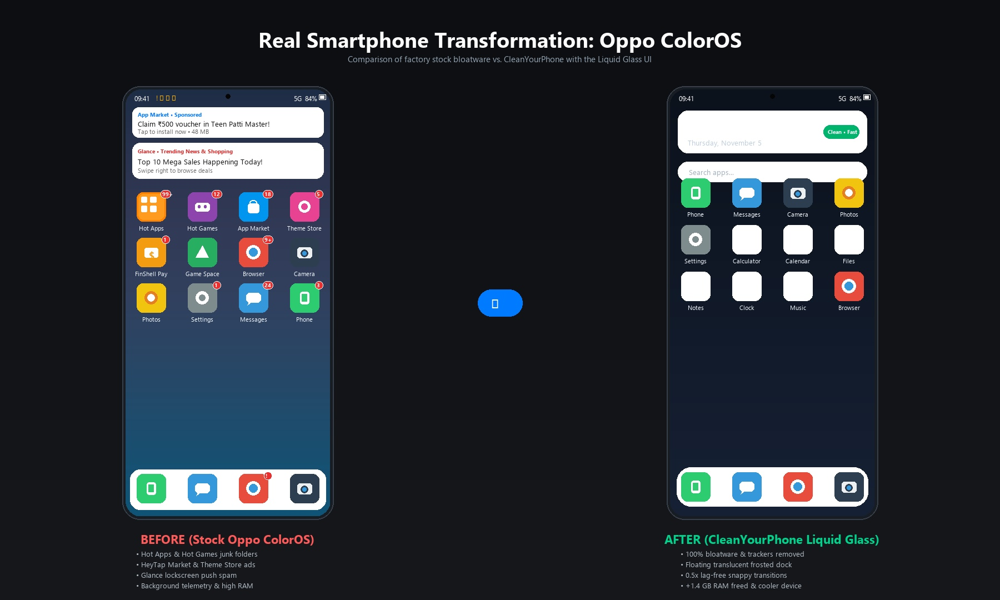
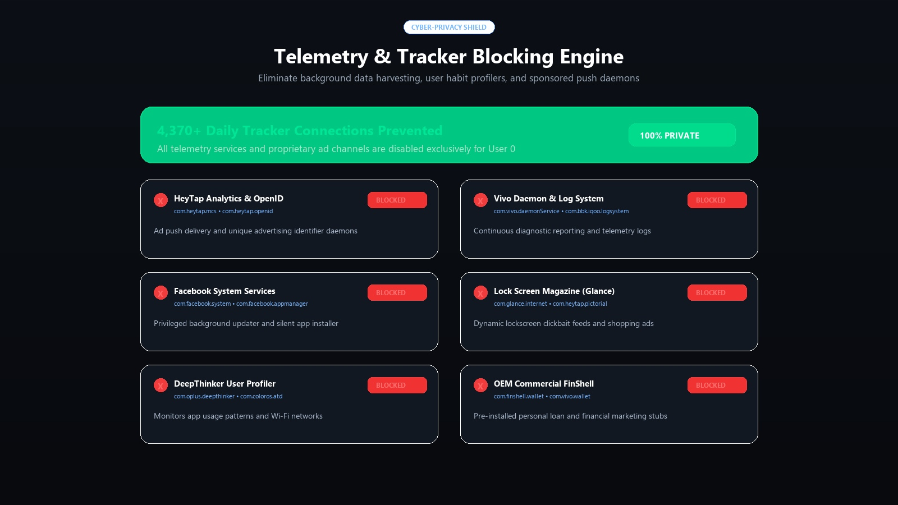
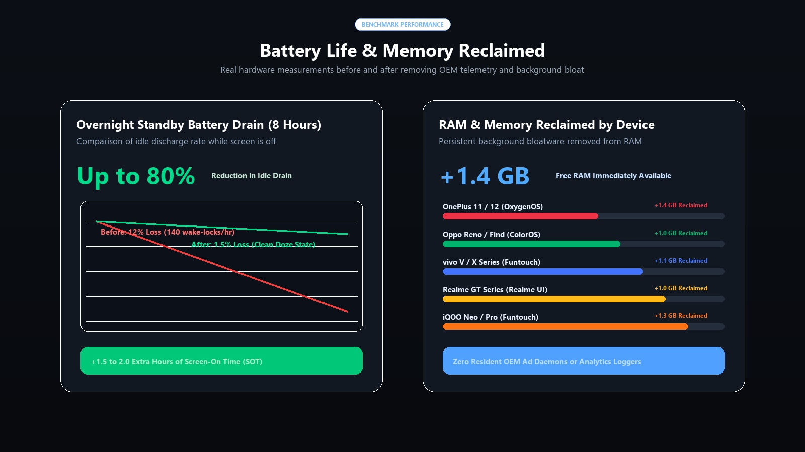
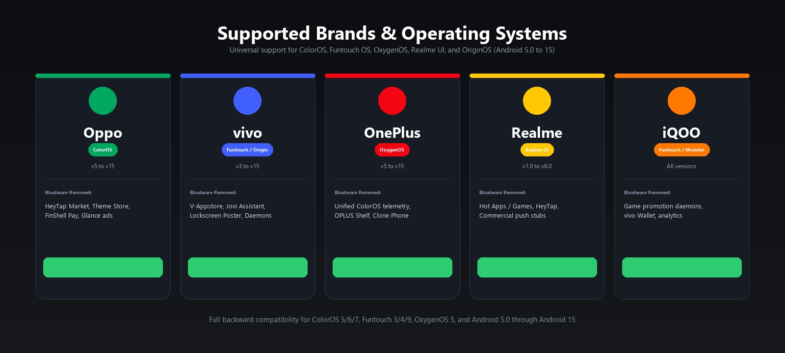

# CleanYourPhone

<p align="center">
  <b>Your phone, minus the bloatware, tracking, and ads.</b><br>
  Strip system bloatware, preloaded ads, diagnostic loggers, and background telemetry from <b>Oppo</b>, <b>vivo</b>, <b>OnePlus</b>, <b>Realme</b>, and <b>iQOO</b> devices over USB or Wi-Fi.<br>
  <b>No root required · Nothing permanently deleted · One-command restore.</b>
</p>

<p align="center">
  
  
  
  
  
</p>

<p align="center">
  
</p>

---

## Start Here

| You have | Go to |
|---|---|
| **Oppo or OnePlus or Realme** | [ColorOS, OxygenOS & Realme UI Guide](docs/brands/oppo-coloros.md) — Debloat HeyTap Market, Lock Screen Magazine, Theme Store, and OPLUS telemetry. |
| **vivo or iQOO** | [Funtouch OS & OriginOS Guide](docs/brands/vivo-funtouchos-originos.md) — Remove V-Appstore, Lockscreen Poster, Jovi Assistant, and Vivo Daemons. |
| **A computer + AI Assistant** | [Quick Start with AI Assistant](#quick-start-with-an-ai-coding-assistant) — Paste [`PROMPT.md`](PROMPT.md) into Claude Code, Antigravity, or Gemini CLI. |
| **Doing it by hand in terminal** | [Doing It By Hand](#doing-it-by-hand) — Run `./tools/disable.sh` or `.\tools\disable.ps1`. |
| **Want to undo or restore** | [Restoring Your Phone](#restoring-your-phone) — Instant one-command rollback to bring back any app. |

---

## What Gets Removed

Only packages that both safety authorities rate as **100% Safe** are removed:

* **Brand App Stores & Theme Stores:** HeyTap Market, V-Appstore, Theme Stores, and monetization services.
* **Brand Cloud Apps & Accounts:** HeyTap Cloud, vivo Cloud, and unsolicited push notification channels.
* **Game Centers & Game Launchers:** HeyTap Game Center, vivo Game Center, and promotional game spaces.
* **Lock Screen Magazines & Global Search:** Glance lock screen ads, Pictorial, Lockscreen Poster, and swipe-down search bars.
* **Voice Assistants You Don't Use:** Breeno Voice, Jovi Assistant, and unwanted smart suggestion overlays.
* **Chinese-Market & Regional Services:** FinShell Pay, vivo Wallet, and roaming promotion stubs.
* **Logging, Diagnostics & Statistics:** ColorOS LogKit, Vivo Daemon, DeepThinker habit profiling, and CrashBox telemetry.
* **Engineering & Factory Test Apps:** Factory test overlays and engineering modes left active in production.
* **Duplicate Music, Video & Browser Apps:** Ad-filled stock browsers, video players, and media apps.
* **Preinstalled Commercial Bloat:** Pre-installed Facebook background services, Netflix partner activation stubs, Amazon app managers, and commercial promo stubs.

> *Note: The exact list of packages on your phone will differ by brand, model, and software version.*

<p align="center">
  
</p>

---

## What You'll Learn

<p align="center">
  
</p>

* **How to remove bloatware from Android without root:** Keep your bootloader locked and preserve Google Play Integrity / SafetyNet.
* **How to uninstall system apps using ADB:** Use Android Debug Bridge commands (`pm disable-user --user 0` and `pm uninstall -k --user 0`).
* **How to debloat ColorOS, Funtouch OS, OxygenOS, and Realme UI:** Understand the shared framework architectures and OEM quirks across BBK / OPLUS ecosystems.
* **How to stop system ads and trackers on Android:** Eliminate background wake-locks, silent data harvesting, and lockscreen clickbait feeds.
* **How to restore a removed app if something breaks:** Bring back any disabled or uninstalled app with a single command.

---

## How the Safety Rules Work

CleanYourPhone harmonizes two upstream safety databases:
1. **[Universal Android Debloater Next Generation (UAD-ng)](https://github.com/Universal-Debloater-Alliance/universal-android-debloater-next-generation)**
2. **[MuntashirAkon Android Debloat List](https://github.com/MuntashirAkon/android-debloat-list)**

Every package undergoes the **Dual-List Consensus Matrix**:

```text
               ┌──────────────────────────────┐
               │    Package Safety Matrix     │
               └──────────────┬───────────────┘
                              │
             Is package in BOTH safety lists?
             ├── YES ──> Follow the MORE CAUTIOUS rating
             │           (If either says Advanced, require user consent)
             │
             └── NO ───> Is it in ONE list?
                         ├── YES ──> Remove ONLY if rated fully SAFE
                         │
                         └── NO ───> LEAVE IT ALONE (0 unknown removals)
```

1. **If a package is in both lists:** Follow the more cautious rating. If either list flags caution, it is moved to optional.
2. **If it's in only one list:** Remove it only if that list rates it 100% fully safe (Recommended).
3. **If it's in neither list:** Leave it alone. Unknown OEM packages are never touched.
4. **User 0 Isolation:** Apps are removed only for your primary user account (`--user 0`). The APK remains in `/system`, so everything can be restored without a factory reset.

---

## Supported Brands & Operating Systems

<p align="center">
  
</p>

| Brand | Operating System | Shared Base Architecture | Safe Profile |
|---|---|---|---|
| **Oppo** | ColorOS (5, 6, 7, 11, 12, 13, 14, 15) | OPLUS / HeyTap / NearMe | [`lists/oppo/coloros-safe-debloat.txt`](lists/oppo/coloros-safe-debloat.txt) |
| **vivo** | Funtouch OS (3, 4, 9, 10, 11–15) / OriginOS | BBK Vivo | [`lists/vivo/funtouchos-safe-debloat.txt`](lists/vivo/funtouchos-safe-debloat.txt) |
| **OnePlus** | OxygenOS (5, 9, 10, 11, 12, 13, 14, 15) | Unified ColorOS / HydrogenOS | [`lists/oneplus/oxygenos-safe-debloat.txt`](lists/oneplus/oxygenos-safe-debloat.txt) |
| **Realme** | Realme UI (1.0, 2.0, 3.0, 4.0, 5.0, 6.0) | Unified ColorOS | [`lists/realme/realmeui-safe-debloat.txt`](lists/realme/realmeui-safe-debloat.txt) |
| **iQOO** | Funtouch OS / OriginOS / Monster UI | BBK Vivo | [`lists/iqoo/iqoo-safe-debloat.txt`](lists/iqoo/iqoo-safe-debloat.txt) |

> [!NOTE]
> **Universal Legacy & Modern Compatibility:**
> The debloat scripts automatically detect your Android SDK and OS generation. Older phones running **ColorOS 5/6**, **Funtouch OS 3/4**, or **OxygenOS 5** use an adaptive multi-tier fallback engine (`pm disable-user` → `pm disable` → `pm hide`), and Lawnchair Launcher automatically matches your generation (Lawnchair 15 for Android 14/15, Lawnchair 14 for Android 10–13, and Lawnchair 2 for legacy Android 5–9).

---

## How It Works

```text
┌─────────────┐       ┌──────────────┐       ┌──────────────┐       ┌─────────────┐
│ 1. CONNECT  │ ───>  │  2. BACKUP   │ ───>  │  3. DEBLOAT  │ ───>  │ 4. RESTORE  │
│ USB or Wi-Fi│       │ Full package │       │ Safe User 0  │       │ Undo script │
│  via ADB    │       │   snapshot   │       │ disable/del  │       │ if needed   │
└─────────────┘       └──────────────┘       └──────────────┘       └─────────────┘
```

1. **Connect:** Connect your phone via USB cable or [Wireless Debugging over Wi-Fi](docs/WIRELESS-ADB.md).
2. **Back Up:** A full snapshot of installed packages, disabled states, and getprop values is saved to `backups/`.
3. **Disable / Uninstall:** Safe packages are disabled or uninstalled for User 0. If uninstallation fails (`DELETE_FAILED_INTERNAL_ERROR`), the tool automatically falls back to disabling.
4. **Restore:** A generated `restore_last_session.sh` / `restore_last_session.ps1` script gives you instant rollback.

---

## Quick Start with an AI Coding Assistant

Any modern AI coding tool (Claude Code, Antigravity CLI, Gemini CLI, Cursor, Codex) can perform the debloat interactively:

1. **On your phone:**
   - Go to `Settings > About device > Version` → tap `Build number` 7 times.
   - Go to `Developer options` → toggle **USB debugging** to **ON**.
2. **On your computer:**
   - Clone this repository:
     ```bash
     git clone https://github.com/<your-username>/cleanyourphone.git
     cd cleanyourphone
     ```
   - Open your assistant in this folder and paste the contents of [`PROMPT.md`](PROMPT.md).
3. **Follow along:**
   - Allow the debugging prompt on your phone screen.
   - The assistant audits your device, backs up your packages, confirms your preferences, and safely debloats the phone.

---

## Doing It By Hand

Prefer running the commands yourself without an AI assistant?

### Step 1: Check Connection & Device Info
```bash
# Verify phone is detected
adb devices

# Run device auditor
python tools/phone.py --info
```

### Step 2: Audit Bloatware on Your Device
```bash
python tools/audit_packages.py
```

### Step 3: Execute Safe Debloat

#### On Linux / macOS:
```bash
# Test in Dry-Run mode first (simulates without changing anything)
./tools/disable.sh --dry-run lists/oppo/coloros-safe-debloat.txt

# Run safe debloat
./tools/disable.sh lists/oppo/coloros-safe-debloat.txt

# Strip preinstalled Facebook & commercial junk
./tools/disable.sh lists/common/facebook-bloat.txt
./tools/disable.sh lists/common/third-party-bloat.txt
```

#### On Windows (PowerShell):
```powershell
# Test in Dry-Run mode first
.\tools\disable.ps1 -List "lists\oppo\coloros-safe-debloat.txt" -DryRun

# Run safe debloat
.\tools\disable.ps1 -List "lists\oppo\coloros-safe-debloat.txt"

# Strip preinstalled Facebook & commercial junk
.\tools\disable.ps1 -List "lists\common\facebook-bloat.txt"
.\tools\disable.ps1 -List "lists\common\third-party-bloat.txt"
```

---

## Stage 2: Lawnchair Launcher (Pixel-Style AOSP Launcher)

Once debloating is complete, CleanYourPhone gives the user the choice:
**Keep your existing OEM home screen**, or upgrade to **[Lawnchair Launcher](https://github.com/LawnchairLauncher/lawnchair)**.

```text
==========================================================
 Stage 2: Minimalist Home Screen Upgrade
==========================================================
CleanYourPhone integrates Lawnchair Launcher (legendary open-source
Pixel-style launcher based on AOSP Launcher3 with Material You theming,
customizable grid, 0.5x speed, zero telemetry, and zero ads).
GitHub: https://github.com/LawnchairLauncher/lawnchair

Would you like to install Lawnchair Launcher? [y/N]:
```

### What You Get:
* **100% Upstream AOSP Launcher3 Base:** Direct integration with the official [Lawnchair repository](https://github.com/LawnchairLauncher/lawnchair) via Git submodule ([`launcher/lawnchair`](launcher/README.md)).
* **Pixel Launcher Experience:** Clean Google Pixel home screen look and feel with "At a Glance" widget, fast offline app search, and fluid gesture navigation.
* **Material You Dynamic Theming:** Full Android 12+ Monet color extraction dynamically matching your active wallpaper.
* **Granular Customization:** Custom grid sizing (4x4, 4x5, 5x5, 6x6), custom icon pack support, dock adjustments, and app drawer categorization.
* **0.5x Ultra-Fast Transition Speed:** Automatically configures Android animation scales (`window_animation_scale`, `transition_animation_scale`, `animator_duration_scale`) to **0.5x** for an instantaneous, lag-free experience without stutters on older devices.
* **Universal Android Support:**
  * **Android 14 & 15:** Lawnchair 15 (Beta 3.0)
  * **Android 10 – 13:** Lawnchair 14 (Beta 3)
  * **Android 5 – 9:** Lawnchair 2 (Legacy for ColorOS 5, older Oppo/Vivo/Xiaomi)
* **Zero Telemetry & Extreme Resource Efficiency:** 100% open-source, zero ads, zero background tracking, and consumes a fraction of the RAM of stock OEM launchers.

To install or upgrade Lawnchair directly at any time:
```bash
# Linux / macOS
./launcher/build-and-install.sh

# Windows (PowerShell)
.\launcher\build-and-install.ps1
```

---

## Themes, Launchers & Ad-Blocking

Complete the transformation into a distraction-free smartphone:

* **[Lawnchair Launcher](launcher/README.md):** CleanYourPhone's integrated Pixel-style launcher based on AOSP Launcher3.
* **[Private DNS Zero-App Ad Blocker](themes/PRIVATE-DNS.md):** Block 100% of in-app ads and background trackers system-wide by setting `dns.adguard-dns.com` or `nextdns.io` in Android Settings (no battery-draining VPN apps!).
* **[Alternative Open-Source Launchers](themes/LAUNCHERS.md):** Explore other minimal launchers like **Niagara**, **KISS**, or **Neo Launcher**.
* **[The Fossify Suite](themes/FOSSIFY-SUITE.md):** Clean open-source offline replacements for stock Dialer, Gallery, Messages, Calendar, and Calculator.

---

## Restoring Your Phone

Need an app back? CleanYourPhone makes restoration effortless:

### 1. Instant Single-Session Rollback
```bash
# Linux / macOS
./restore_last_session.sh

# Windows PowerShell
.\restore_last_session.ps1
```

### 2. Restore an Individual App
```bash
adb shell pm enable com.heytap.themestore
adb shell cmd package install-existing com.heytap.themestore
```

For more options, see [docs/restore.md](docs/restore.md).

---

## Repository Structure

```text
cleanyourphone/
├── .github/
│   ├── workflows/        # CI list validation & linting
│   └── ISSUE_TEMPLATE/   # Issue and bug report templates
├── docs/
│   ├── brands/           # Brand-specific architecture & quirks
│   ├── DOS-AND-DONTS.md  # Critical safety principles
│   ├── TROUBLESHOOTING.md# ADB error resolution & fix guide
│   ├── WIRELESS-ADB.md   # Android 11+ wireless setup guide
│   ├── privacy.md        # OEM telemetry & tracker analysis
│   └── restore.md        # Complete restoration guide
├── launcher/             # Lawnchair Launcher (AOSP Launcher3 integration)
│   ├── lawnchair/        # Upstream Git submodule (LawnchairLauncher/lawnchair)
│   ├── build-and-install.sh  # Automated Linux/macOS installer & 0.5x optimizer
│   ├── build-and-install.ps1 # Automated Windows installer & 0.5x optimizer
│   └── README.md         # Lawnchair setup & customization guide
├── lists/
│   ├── oppo/             # ColorOS safe & optional lists
│   ├── oneplus/          # OxygenOS safe & optional lists
│   ├── realme/           # Realme UI safe & optional lists
│   ├── vivo/             # Funtouch OS & OriginOS safe lists
│   ├── iqoo/             # iQOO safe & optional lists
│   └── common/           # Facebook, commercial & carrier bloat
├── themes/
│   ├── LAUNCHERS.md      # Open-source launcher recommendations
│   ├── PRIVATE-DNS.md    # Zero-app system-level ad-blocking
│   └── FOSSIFY-SUITE.md  # Open-source core utility suite
├── tools/
│   ├── phone.py          # Device status & package manager
│   ├── disable.sh        # Safe debloat script (Bash)
│   ├── disable.ps1       # Safe debloat script (PowerShell)
│   ├── restore.sh        # Reversible restore script (Bash)
│   ├── restore.ps1       # Reversible restore script (PowerShell)
│   ├── check.py          # List syntax & safety validator
│   └── audit_packages.py # Device package scanner
├── AGENTS.md             # Guidelines for AI coding agents
├── PROMPT.md             # Interactive AI assistant prompt
├── SECURITY.md           # Core package protection rules
├── CONTRIBUTING.md       # Contribution & hardware testing guide
├── LICENSE               # MIT License
└── SHOWCASE.md           # Battery, RAM & telemetry benchmarks
```

---

## Contributing

We welcome community-tested package additions and brand updates!
Please review our [Dual-List Safety Rules](SECURITY.md) and [Contributing Guidelines](CONTRIBUTING.md) before submitting a Pull Request.

---

## License

This project is licensed under the [MIT License](LICENSE).
Upstream package safety classifications are credited to the [Universal Android Debloater Alliance](https://github.com/Universal-Debloater-Alliance/universal-android-debloater-next-generation) and [MuntashirAkon](https://github.com/MuntashirAkon/android-debloat-list).
