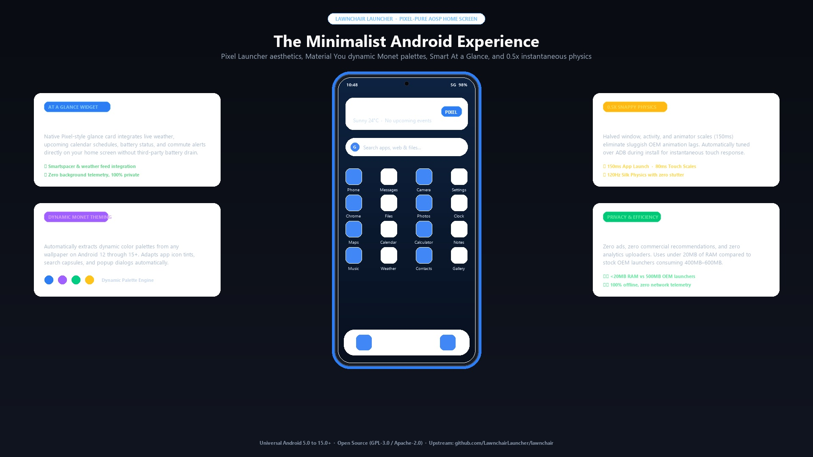
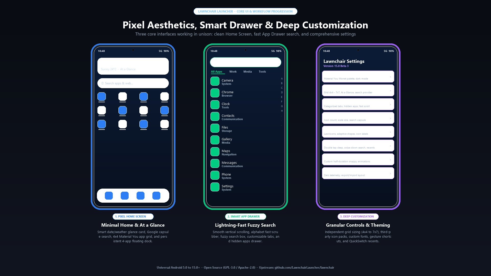
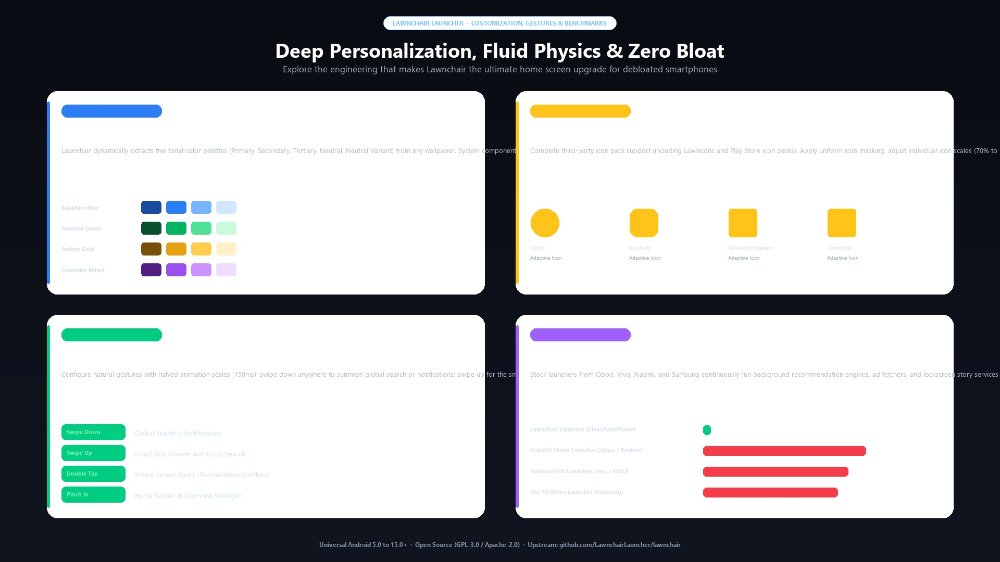

# Google Stock Launcher (CleanYourPhone Integration)

[](https://github.com/LawnchairLauncher/lawnchair)
[](https://github.com/LawnchairLauncher/lawnchair/blob/15-beta/LICENSE.txt)
[](#supported-android-versions)

**CleanYourPhone** integrates **Google Stock Launcher** (powered by the Lawnchair / AOSP Launcher3 upstream base)—the legendary free and open-source Android home screen replacement based on AOSP Launcher3. It brings the pure Google Pixel launcher experience to any device, enriched with deep customization, dynamic Material You theming, and an uncompromising commitment to privacy and zero bloat.

The upstream source tree is integrated directly as a Git submodule at [`launcher/lawnchair`](https://github.com/LawnchairLauncher/lawnchair) pinned to official releases.

<p align="center">
  
</p>

---

## What Does the UI Look Like?

Google Stock Launcher delivers an uncluttered, distraction-free interface engineered for instant ergonomics:

1. **Smart "At a Glance" Card:**
   - Prominently displays the current day, date, and live local weather (`Sunny 24°C`) alongside calendar alerts and alarms.
   - Built-in Smartspacer and weather feed support with zero background battery drain.
2. **Unified Search Capsule:**
   - Floating search bar at the top or bottom of the screen with quick access to local apps, web search engines (Google, DuckDuckGo, Brave), and system shortcuts.
3. **Themed Material You App Grid:**
   - Symmetrical 4x4, 4x5, or 5x5 app grid featuring adaptive squircles tinted dynamically with colors extracted from your active wallpaper.
4. **Anchored Floating Dock:**
   - Streamlined floating dock pill at the bottom holding your 4 or 5 primary communication and utility apps (Phone, Messages, Browser, Camera).

---

## Special Features of Google Stock Launcher

<p align="center">
  
</p>

### 1. Dynamic Monet Wallpaper Palette Theming
Google Stock Launcher incorporates Android 12+ Material 3 Expressive theming. When you change your wallpaper, it automatically recalculates five tonal palettes (Primary, Secondary, Tertiary, Neutral, Neutral Variant) and applies harmonious color accents across app icons, search capsules, dialogs, and folders.

### 2. Smart App Drawer & Real-Time Fuzzy Search
- **Instant Filtering:** Swipe up anywhere on the home screen to open the app drawer. Typing immediately filters installed applications with sub-millisecond response.
- **Categorized Tabs:** Group your apps into custom tabs (Work, Media, Games, Finance) or hide apps from view without uninstalling them.
- **Alphabet Quick-Scrubber:** Jump directly to any letter in your app catalog with a silky haptic touch scrubber.

### 3. Granular Customization Engine
- **Custom Icon Packs:** Full compatibility with Lawnicons, Google Material icons, and third-party icon packs from GitHub or Play Store.
- **Adaptive Icon Shapes:** Force uniform icon geometry across all apps (Circle, Squircle, Rounded Square, Teardrop).
- **Adjustable Grid Sizing:** Freely configure home screen and drawer rows/columns from 4x4 up to 7x7.
- **Dock Adjustments:** Customize icon counts, scale dock sizes from 70% to 150%, or hide labels completely.

### 4. 0.5x Ultra-Fast Transition Speed & Physics
CleanYourPhone automatically clocks animation scales to **0.5x** over ADB during install:
- **150ms App Launch Transitions:** Custom half-duration zoom & activity changes.
- **80ms Touch Physics:** Instantaneous feedback when tapping icons or swiping between pages.
- **Zero Lag on Any Hardware:** Silky 60Hz, 90Hz, and 120Hz refresh rates without frame drops, even on older or budget devices.

<p align="center">
  
</p>

### 5. Extreme Resource Efficiency & Zero Bloat
- **<20 MB RAM Consumption:** Compared to heavy OEM launchers (Samsung One UI Home, Xiaomi MIUI Home, ColorOS Home, Funtouch Launcher, Transsion HiOS Launcher) that constantly run 350MB–600MB recommendation daemons in the background.
- **100% Offline & Private:** Zero ads, zero commercial recommendations, zero tracking SDKs, and zero network analytics uploaders.

---

## Supported Android Versions

The CleanYourPhone installer automatically inspects the connected device via ADB and delivers the optimal edition for your Android build:

| Android Version | SDK Level | Release Edition | Upstream Branch |
|---|---|---|---|
| **Android 14 & 15** | SDK 34–35+ | **Google Stock Launcher 15 (v15 Beta)** | `15-beta` |
| **Android 10 – 13** | SDK 29–33 | **Google Stock Launcher 14 (v14 Beta)** | `14-beta` |
| **Android 5 – 9** (ColorOS 5, older Samsung/Oppo/Vivo) | SDK 21–28 | **Stock Launcher 2.0 (Legacy AOSP)** | `legacy` |

---

## Installation & Setup

### Automated (One-Click ADB Installer)

Connect your phone via USB or Wireless ADB with USB Debugging enabled, then run:

#### Windows (PowerShell):
```powershell
.\launcher\build-and-install.ps1
```
*To automatically disable your OEM stock launcher (Samsung, POCO, Transsion, Oppo, Vivo, Motorola, etc.):*
```powershell
.\launcher\build-and-install.ps1 -DisableStock
```

#### Linux / macOS (Bash):
```bash
./launcher/build-and-install.sh
```
*To automatically disable your OEM stock launcher:*
```bash
./launcher/build-and-install.sh --disable-stock
```

The script will automatically:
1. Detect your connected device's manufacturer and Android SDK level.
2. Provide or download the matching official signed release APK directly from the upstream repository.
3. Install the APK via `adb install -r -d`.
4. Set Google Stock Launcher as your primary home activity (`cmd package set-home-activity` / `pm set-home-activity`).
5. Tune animation speeds to **0.5x** for immediate, stutter-free performance.
6. Launch Google Stock Launcher directly onto your device.

---

## Building from Source

The complete upstream repository is included as a Git submodule:

```bash
# Initialize and fetch the upstream repository
git submodule update --init --recursive launcher/lawnchair

# Build release APK using Gradle
cd launcher/lawnchair
./gradlew assembleLawnchairRelease
```

---

## Credits & Upstream Repository
- **Upstream Project:** [Lawnchair Launcher](https://github.com/LawnchairLauncher/lawnchair)
- **Website:** [https://lawnchair.app](https://lawnchair.app)
- **License:** GNU General Public License v3.0 / Apache License 2.0
